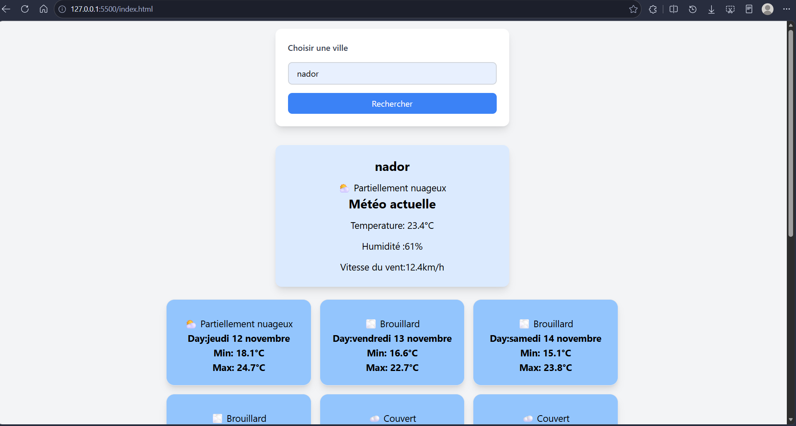

# 🌤️ Weather App

## Présentation

Weather App est une application web qui permet de consulter la météo actuelle et les prévisions météorologiques d'une ville à partir de son nom.

Le projet utilise les API **Open-Meteo** pour récupérer les informations météorologiques.

## Fonctionnalités

- Rechercher une ville par son nom.
- Afficher la température actuelle.
- Afficher l'humidité et la vitesse du vent.
- Afficher les prévisions météorologiques sur 14 jours.
- Afficher une description et une icône selon les conditions météorologiques.
- Gérer les erreurs de recherche et les problèmes de connexion.
- Réessayer la dernière recherche grâce au bouton « Réessayer ».

## Technologies utilisées

- HTML5
- CSS3
- Tailwind CSS
- JavaScript
- Fetch API
- Open-Meteo API

## Installation et lancement

### 1. Cloner le projet

```bash
git clone https://github.com/benddri/Weather-App.git
```

### 2. Accéder au dossier

```bash
cd Weather-App
```

### 3. Lancer le projet

Ouvrir le fichier `index.html` avec l'extension **Live Server** de VS Code.

## Intégration des API

Le projet utilise deux API Open-Meteo.

### 1. Geocoding API

**Endpoint :**

`https://geocoding-api.open-meteo.com/v1/search`

**Paramètre utilisé :**

- `name` : nom de la ville recherchée.

Cette API permet de récupérer les coordonnées géographiques (latitude et longitude) d'une ville.

### 2. Forecast API

**Endpoint :**

`https://api.open-meteo.com/v1/forecast`

**Principaux paramètres utilisés :**

| Paramètre | Description |
|---|---|
| `latitude` | Latitude de la ville |
| `longitude` | Longitude de la ville |
| `current` | Données météorologiques actuelles |
| `daily` | Prévisions météorologiques quotidiennes |
| `forecast_days` | Nombre de jours de prévisions (14) |
| `wind_speed_unit` | Unité de vitesse du vent (km/h) |
| `timezone` | Fuseau horaire automatique |

## Limites de l'API

Open-Meteo propose une utilisation gratuite pour les projets non commerciaux, sans clé API.

Les limites annoncées pour l'offre gratuite sont notamment :

- Moins de 10 000 appels par jour.
- 5 000 appels par heure.
- 600 appels par minute.

Pour limiter les requêtes, l'application appelle les API uniquement lors d'une recherche ou d'une nouvelle tentative avec le bouton « Réessayer ».

Consulter les conditions officielles : https://open-meteo.com/en/terms

## Exemple de réponse JSON

Voici un exemple simplifié de réponse de la Forecast API :

```json
{
  "current": {
    "temperature_2m": 23.4,
    "relative_humidity_2m": 61,
    "weather_code": 2,
    "wind_speed_10m": 12.4
  },
  "daily": {
    "time": ["2026-11-13"],
    "temperature_2m_min": [16.6],
    "temperature_2m_max": [22.7],
    "weather_code": [45]
  }
}
```

### Affichage des données

| Donnée JSON | Affichage dans l'application |
|---|---|
| `temperature_2m` | Température actuelle |
| `relative_humidity_2m` | Humidité |
| `wind_speed_10m` | Vitesse du vent |
| `weather_code` | Description et icône météo |
| `time` | Date des prévisions |
| `temperature_2m_min` | Température minimale |
| `temperature_2m_max` | Température maximale |

Les données JSON sont récupérées avec `fetch()`, puis utilisées avec JavaScript pour afficher les informations météorologiques dans la page.

## Gestion des erreurs

L'application gère plusieurs situations :

- Ville introuvable : affichage du message « Ville introuvable ! ».
- Problème de connexion : affichage d'un message demandant de vérifier le réseau.
- Erreur du service API : affichage d'un message indiquant que le service est indisponible.
- Limite de requêtes atteinte : affichage d'un message adapté.
- Bouton « Réessayer » : permet de relancer la dernière recherche.

## Screenshots

### Interface principale



## Tests manuels

Les tests de la gestion des erreurs sont documentés dans le fichier `TEST-LOG.md`.

Les scénarios testés comprennent :

- Recherche d'une ville inconnue.
- Désactivation du réseau.
- Simulation d'une erreur API 500.
- Nouvelle tentative après rétablissement de la connexion.

## Structure du projet

```text
Weather-App/
│
├── index.html
├── README.md
├── TEST-LOG.md
│
├── screenshots/
│   └── weather-app.png
│
│
└── js/
    └── script.js
```

## Clé API

Ce projet utilise Open-Meteo et ne nécessite aucune clé API.

Aucune clé API n'est donc stockée dans le projet.

## Auteur

**Fatima Benddri**

Projet réalisé dans le cadre de la formation Développement Web à YouCode Nador.

## Sources

- Documentation Forecast API : https://open-meteo.com/en/docs
- Documentation Geocoding API : https://open-meteo.com/en/docs/geocoding-api
- Conditions d'utilisation : https://open-meteo.com/en/terms

Weather data provided by [Open-Meteo](https://open-meteo.com/).